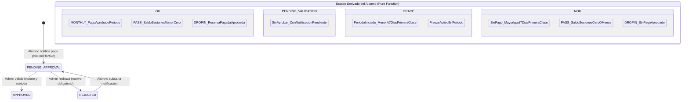
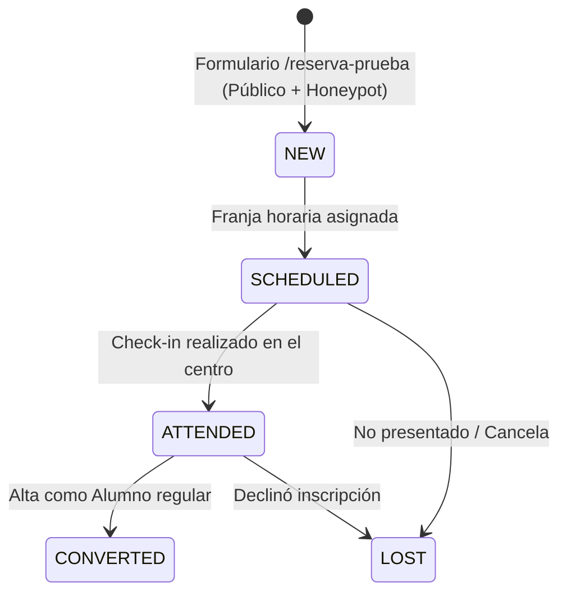
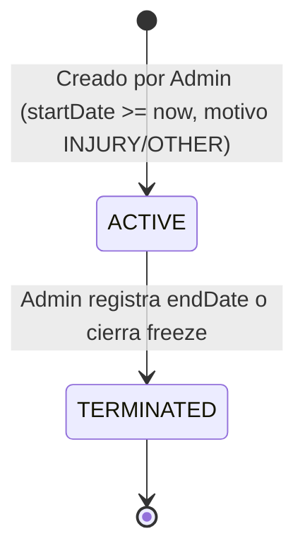
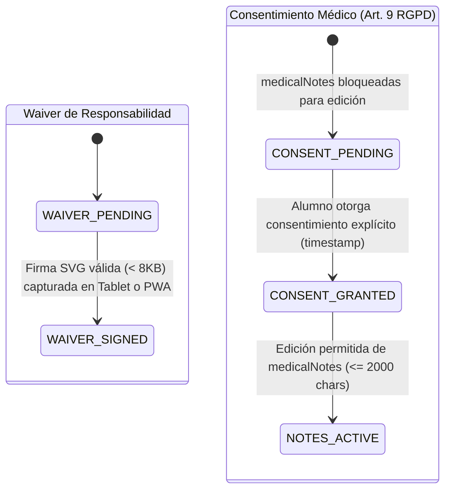

# ESPECIFICACIÓN TÉCNICA Y FUNCIONAL MVP: 247STUDIO WEBAPP

## 1. RESUMEN EJECUTIVO Y OBJETIVO
El proyecto **247Studio WebApp** digitaliza la operativa integral de la academia de artes marciales *247Studio* (BJJ y disciplinas afines), sustituyendo el canal manual vía WhatsApp por una plataforma web progresiva (PWA) de autoservicio para el alumno, una consola administrativa para gestión y caja, y un modo kiosco en tablet para el control de asistencia y check-in presencial.

---

## 2. ARQUITECTURA GENERAL Y DECISIONES TÉCNICAS

### 2.1 Stack Tecnológico
- **Frontend Core:** React 18 / 19 + TypeScript (Strict Mode) sobre Vite.
- **Estilos:** Tailwind CSS con tokens corporativos `#11152E` (Navy), `#E60000` (Red), `#D8D2B8` (Cream) y `#FFFFFF` (White).
- **Backend as a Service:** Firebase Authentication + Cloud Firestore (Plan Spark).
- **Hosting & CI/CD:** Netlify (`247studio-app.netlify.app`), SPA rewrite `/* -> /index.html 200`.
- **Testing:** Vitest para lógica de dominio pura y `@firebase/rules-unit-testing` con Firebase Local Emulator Suite para reglas de seguridad.

### 2.2 Principios de Diseño del Software
1. **Feature-Sliced Design (FSD):** División estricta en capas (`app`, `pages`, `widgets`, `features`, `entities`, `shared`) con slices acoplados únicamente en sentido descendente.
2. **Arquitectura Hexagonal en Capa de Dominio (`src/shared/domain`):**
   - Lógica de negocio 100% pura y agnóstica de frameworks o librerías externas (prohibido importar React, Firebase, Firestore SDK o dependencias I/O).
   - Inyección determinista del tiempo: **prohibido `Date.now()` o `new Date()` sin inyección**. Toda función recibe el parámetro explícito `now: Date`.
3. **Manejo Monetario y Fiscal:**
   - Todo importe monetario se expresa en **céntimos enteros** (`integer`), mitigando errores de coma flotante IEEE 754.
   - Zona horaria de referencia: `Europe/Madrid`.
   - Cálculo de desglose de IVA (invariante matemática `base + vat === total`):
     $$\text{baseCents} = \text{round}\left(\frac{\text{totalCents}}{1 + \text{vatRate}}\right)$$
     $$\text{vatCents} = \text{totalCents} - \text{baseCents}$$
     *(Prohibida cualquier aproximación como `total * 0.79`).*
4. **Cálculo Derivado vs. Estado Almacenado:**
   - La plataforma no depende de ejecuciones periódicas o cron jobs. El estado de membresía y pago se deriva en tiempo real como una función pura sobre el historial de pagos, registros de asistencia y fecha actual.
   - Los campos `paymentStatusCache` y `retentionRiskCache` en la colección `users` son de uso administrativo/indexado y jamás constituyen la fuente de verdad.
5. **Control de Acceso basado en Custom Claims:**
   - Roles: `student` (default), `admin`, `kiosk`.
   - Asignación segura mediante script de node con Admin SDK (`scripts/set-admin-claim.mjs`).
   - Las reglas de Firestore inspeccionan únicamente `request.auth.token.role`, eliminando por completo lecturas `get()` a la base de datos dentro del motor de seguridad.

---

## 3. MODELO DE ROLES Y MATRIZ DE PERMISOS

| Rol | Ámbito | Autenticación | Permisos Clave |
| :--- | :--- | :--- | :--- |
| **Público (Anónimo)** | Web pública / Reserva | Ninguna / App Check | Crear lead en `/reserva-prueba` (`honeypot == ''`), leer `schedules` activos y `scheduleExceptions`. |
| **Student** | PWA Alumno | Firebase Auth (`student`) | Ver propio perfil, horarios, crear auto-reserva (`BOOKED`/`WAITLISTED`), cancelar reservas en plazo, reportar pagos (`PENDING_APPROVAL`), actualizar datos de contacto, firmar waiver, otorgar consentimiento médico y editar `medicalNotes`. |
| **Kiosk** | Tablet Check-in | Firebase Auth (`kiosk`) | Consultar nombres y horarios del día (sin datos financieros ni médicos), actualizar o registrar `bookings` exclusivamente con estado `ATTENDED` y origen `TABLET`. Protegido por PIN físico para salir a entorno admin. |
| **Admin** | Consola de Gestión | Firebase Auth (`admin`) | Acceso total a BBDD personal, validación/rechazo de pagos, modificación de tarifas y excepciones de calendario, aprobación de altas de menores, cierre de freezes, auditoría de retención y override de cancelaciones. |

---

## 4. RUTAS DE LA APLICACIÓN

### 4.1 Rutas Públicas
- `/reserva-prueba`: Formulario de captación de lead y selección de clase de prueba gratuita.
- `/login`: Autenticación de usuarios con redirección dinámica según rol (`admin` $\rightarrow$ `/admin/personal`, `student` $\rightarrow$ `/app/home`, `kiosk` $\rightarrow$ `/kiosk/check-in`).
- `/registro`: Formulario de alta para mayores de 16 años. Validación de edad en cliente antes de interactuar con Firebase Auth.
- `/terminos` y `/privacidad`: Documentos legales y política de protección de datos conforme a RGPD.

### 4.2 Rutas Privadas: PWA del Alumno (`/app`)
- `/app/home`: Dashboard principal con tarjeta de atleta (cinturón, grados, foto, semáforo gigante con estado e icono, Ficha de Luchador con 8 barras de atributos).
- `/app/programas`: Detalle de tarifa activa, instrucciones de pago y formulario para notificar abono por Bizum o Metálico.
- `/app/horario`: Vista semanal con franjas horarias, estado de clase (En Curso / Siguiente Clase), profesor asignado, cupo y reserva / lista de espera.
- `/app/perfil`: Datos personales, contacto de emergencia, notas médicas (bajo consentimiento explícito), estado del waiver y visualización de congelaciones activas.

### 4.3 Rutas Privadas: Consola de Administración (`/admin`)
- `/admin/personal`: BBDD interactiva con búsqueda, filtros por tarifa y estado, editor de grados/stats, activación de usuarios `PENDING`, alertas de retención y alertas médicas.
- `/admin/caja`: Seguimiento mensual de ingresos, validación 1-click de pagos pendientes, desglose de Base e IVA, arqueo de caja e inventario de saldo de bonos PASS.
- `/admin/horarios`: Configuración de franjas, capacidades, profesores asignados y gestión de `scheduleExceptions`.
- `/admin/tarifas`: Catálogo de tarifas vigentes y archivo de tarifas históricas.
- `/admin/leads`: Gestión del embudo de captación (`NEW` $\rightarrow$ `SCHEDULED` $\rightarrow$ `ATTENDED` $\rightarrow$ `CONVERTED` / `LOST`).
- `/admin/alta-menor`: Formulario presencial para que el administrador cree cuentas de dependientes menores de 16 años tras reunión con el tutor legal.

### 4.4 Ruta Privada: Modo Kiosco (`/kiosk`)
- `/kiosk/check-in`: Pantalla completa táctil para auto check-in rápido mediante búsqueda por nombre (mínimo 2 letras), selección de rol de sesión y confirmación instantánea. Salida protegida por PIN.

---

## 5. MÁQUINAS DE ESTADO DEL DOMINIO

### 5.1 Máquina de Estado de Pagos y Membresía

#### Reglas de Evaluación de Membresía (`derivePaymentStatus`):
1. **Modalidad `MONTHLY` (incluye Familiares `FAM`):**
   - Si existe un pago con estado `APPROVED` para el periodo actual (`YYYY-MM`) $\rightarrow$ `OK`.
   - Si no existe pago `APPROVED` pero sí un pago en `PENDING_APPROVAL` $\rightarrow$ `PENDING_VALIDATION`.
   - Si no hay pago aprobado, pero el usuario posee un `freeze` activo en `now` $\rightarrow$ `GRACE`.
   - Si no hay pago aprobado ni pendiente: se analiza la fecha de la primera clase con estado `ATTENDED` en el periodo (en cuentas familiares, la primera asistencia de cualquiera de los miembros del grupo familiar). Si han transcurrido $\ge 7$ días respecto a `now` $\rightarrow$ `NOK`.
   - En cualquier otro escenario dentro del periodo (e.g., días 1 al 6 o sin asistencias aún registradas) $\rightarrow$ `GRACE`.
2. **Modalidad `PASS` (Bono de sesiones):**
   - Saldo disponible $= \sum \text{sessionsIncluded (pagos APPROVED)} - \text{count}(\text{bookings ATTENDED})$.
   - Si $\text{Saldo} > 0 \rightarrow$ `OK`.
   - Si $\text{Saldo} \le 0 \rightarrow$ `NOK`.
   - No aplica regla de 7 días ni caducidad temporal ni congelaciones.
3. **Modalidad `DROP_IN`:**
   - Cada clase requiere un pago asociado vía `bookingId`.
   - Con pago `APPROVED` $\rightarrow$ `OK`; sin él $\rightarrow$ `NOK`.

### 5.2 Máquina de Estado de Leads (Clases de Prueba)

### 5.3 Máquina de Estado de Congelaciones (`freezes`)

### 5.4 Máquina de Estado de Consentimientos (RGPD y Waiver)

---

## 6. FLUJOS OPERATIVOS CRÍTICOS

### 6.1 Flujo de Registro y Alta de Menores de 16 Años
1. **Doble Umbral Etario:**
   - **Umbral Legal de Auto-registro (16 años):** Conforme a la legislación vigente y LOPDGDD en España, un menor de 16 años no puede celebrar contratos ni consentir tratamiento de datos en plataformas telemáticas de forma autónoma. El cliente valida la fecha de nacimiento ingresada en `/registro`. Si la edad calculada a la medianoche de `Europe/Madrid` es $< 16$, la interfaz cancela el envío y redirige al flujo tutelado con advertencia explícita. Las reglas de Firestore aplican rechazo estricto si se intenta crear un documento en `users` con fecha que resulte en $< 16$.
   - **Umbral de Categoría Deportiva (18 años):** Todo alumno con edad $< 18$ pertenece a la categoría formativa infantil/juvenil (`KID`), rigiéndose por el sistema de cinturones `KIDS` (blanco, gris, amarillo, naranja, verde y sus variantes). Al cumplir 18 años, la función de dominio clasifica al alumno como `ADULT`. La BBDD de Personal alerta al administrador para efectuar la graduación al sistema de cinturones de adultos (`ADULT`).
2. **Procedimiento Presencial para Menores de 16:**
   - El tutor acude a las instalaciones del gimnasio para una reunión informativa.
   - El administrador accede a `/admin/alta-menor`.
   - Se introducen los datos del menor asociando el campo `guardianUid` al UID del tutor (creando previamente la cuenta del tutor si no existiera).
   - El tutor firma digitalmente el waiver y el consentimiento del Art. 9 del RGPD para los datos médicos del menor directamente en la tablet del centro.
   - La cuenta del menor se crea en estado `ACTIVE` o `PENDING` autorizada.

### 6.2 Flujo de Firma de Waiver de Exoneración de Responsabilidad
1. Ningún alumno puede participar en sesiones con contacto (`canAttend(user, booking) === true`) si `waiverSignedAt` es nulo o su versión es inferior a `config.waiverVersion`.
2. **Método Tablet:** En la recepción del centro, el alumno o tutor visualiza el texto del waiver y estampa su firma manuscrita sobre el canvas táctil. El componente vectoriza el trazo generando una cadena SVG estándar optimizada ($\le 8192$ bytes que inicia estrictamente con `<svg`).
3. **Método PWA:** El alumno puede revisar los términos desde `/app/perfil` y firmar directamente desde su dispositivo móvil.
4. Las reglas de seguridad de Firestore impiden la alteración de los campos `waiver*` por parte de un usuario con rol de estudiante durante la edición de perfil estándar, permitiéndose únicamente mediante la transacción autorizada de formalización de alta o firma validada.

### 6.3 Flujo de Baja y Reactivación de Alumnos
1. **Baja Definitiva:**
   - El administrador conmuta `accountStatus` a `INACTIVE` en la ficha del usuario.
   - De forma inmediata, el selector de autenticación o el middleware de rutas bloquea el acceso del alumno a la reserva de clases en la PWA.
   - Las reglas de Firestore prohíben la creación de nuevos `bookings` a usuarios cuyo `accountStatus != 'ACTIVE'`.
2. **Reactivación:**
   - El administrador conmuta nuevamente el estado a `ACTIVE`, asignando una tarifa vigente en `activeTariffId`.
   - Se reinicia el cálculo de cobro en el mes en curso. Si no existen pagos registrados, el alumno dispondrá de 7 días de gracia desde su primera asistencia reactivada.

---

## 12. SITIO PÚBLICO VS APP

### 12.1 Decisión de producto
La aplicación tiene dos superficies con propósitos distintos y layouts distintos:

- **Sitio público (LandingPage):** puerta de entrada para visitantes no autenticados. Su objetivo es captar leads y dar información básica del gimnasio. CTA principal: "Reserva tu clase de prueba" → `/reserva-prueba`. CTA secundario: "Acceder" → `/login`.
- **App privada (`/app/*`, `/admin/*`, `/kiosk/*`):** área autenticada con `AppLayout` (bottom-nav móvil) o `AdminLayout` (sidebar). No comparte layout con la landing.

### 12.2 Mapa de rutas
| Ruta | Acceso | Layout | Redirección si autenticado |
|---|---|---|---|
| `/` | Público | `LandingLayout` | No redirige; muestra botón "Ir a mi panel" |
| `/reserva-prueba` | Público | `LandingLayout` | No redirige |
| `/login` | Público | `LandingLayout` (o layout mínimo) | Redirige por rol o por `redirect` param |
| `/app/*` | Student | `AppLayout` | — |
| `/admin/*` | Admin | `AdminLayout` | — |
| `/kiosk/*` | Kiosk o Admin | Layout mínimo kiosco | — |
| `/registro` | — | — | **Eliminada**. Redirige a `/` |

Netlify ya cubre el fallback SPA (`/* → /index.html, 200`). No requiere cambios en `netlify.toml`.

### 12.3 Comportamiento por estado de sesión
- **Visitante no autenticado en `/`:** ve la landing completa.
- **Alumno autenticado en `/`:** ve la landing con un botón persistente en el header: "Hola, {alias} — Ir a mi panel" → `/app/home`. No se auto-redirige.
- **Admin autenticado en `/`:** igual, pero el botón va a `/admin/personal`.
- **Usuario autenticado en `/login`:** redirección automática por rol (o por `redirect` param si existe y es válido).
- **Usuario no autenticado en `/app/*`:** redirección a `/login?redirect={rutaOriginal}`.

### 12.4 Reglas de navegación
- `ProtectedRoute` acepta el usuario sin sesión y lo envía a `/login?redirect={pathname+search}`.
- `LoginPage` tras login exitoso:
  1. Lee `redirect` del query string.
  2. **Valida** que empiece por `/app`, `/admin` o `/kiosk` (whitelist de prefijos). Si no, lo descarta.
  3. Navega al `redirect` validado, o al home por rol si no hay.
- **Prohibido open redirect**: nunca navegar a URLs absolutas (`http://`, `https://`, `//`) ni a rutas fuera de la whitelist.

### 12.5 Estructura de la LandingPage
- **Header:** logo 247Studio · nav (Programas, Horario, Contacto) · "Acceder" (secundario) · "Ir a mi panel" si autenticado.
- **Hero:** claim + subtítulo + **un único CTA grande**: "Reserva tu clase de prueba" → `/reserva-prueba`.
- **Programas:** 8 cards con los programas reales (BJJ GI, GRAPPLING, KIDS 1, KIDS 2, MMA, LUCHA, BJJ FEM, OPEN MAT).
- **Horario preview:** lectura pública de `schedules` activos, próximos 7 días, 3–4 franjas destacadas + "Ver horario completo" → `/reserva-prueba`.
- **Instructores:** Mario y David.
- **CTA final:** "¿Listo para probar?" → `/reserva-prueba`.
- **Footer:** dirección, redes, **enlace visible a https://www.247studiobjj.com** ("Web oficial"), privacidad, términos.

Sin barra inferior de PWA. La landing no importa Firebase Auth directamente ni carga el emulador.

### 12.6 `AuthProvider`: render no bloqueante
El `AuthProvider` **nunca** retorna `null` ni un spinner global esperando a Firebase Auth. Siempre renderiza a sus hijos. Expone `{ user, role, loading }`. Solo `ProtectedRoute` y `LoginPage` consumen `loading` para decidir si mostrar el contenido o el spinner. La landing se renderiza inmediatamente sin flash blanco.

### 12.7 Ajuste del `manifest.json`
- `start_url: "/app/home"`
- `scope: "/"`

Motivo: la PWA instalada por un alumno debe abrir directamente su área privada. Si no hay sesión, `ProtectedRoute` lo redirige a `/login?redirect=/app/home`. La landing sigue accesible en el navegador móvil.

### 12.8 SEO: decisión y limitación
La landing **no sustituye** a `247studiobjj.com` como web comercial. Es un **hub de captación secundario**. Sin prerender estático, una SPA no se indexa bien en Google. Decisión de MVP:

- No se implementa SSG ni prerender en esta fase.
- El footer enlaza a `247studiobjj.com` como web oficial.
- Si en el futuro la landing debe ser la web comercial principal, se evaluará `vite-plugin-ssg` o similar. Documentado como limitación conocida y salida futura.

### 12.9 Modo kiosco
La tablet abre directamente `/kiosk/check-in`, sin pasar por la landing. Netlify fallback cubre la ruta. El modo kiosco no forma parte del flujo público.

### 12.10 Fuera de alcance del sitio público (MVP)
- Blog / noticias.
- Formulario de contacto genérico (el único formulario público es `/reserva-prueba`).
- Multi-idioma.
- Autenticación social (Google, Facebook).
- Prerender / SSG.

---

## 7. RIESGOS, SUPUESTOS Y MITIGACIONES TÉCNICAS

1. **Cuota y Límites del Plan Firebase Spark:**
   - *Riesgo:* Superación de los límites gratuitos de Firestore (20.000 escrituras/día, 50.000 lecturas/día).
   - *Mitigación:* Para un censo de 150 a 200 alumnos, el volumen operacional pico se estima en $< 1.200$ escrituras y $< 15.000$ lecturas diarias. Se configuran alertas presupuestarias en Google Cloud Platform a $0,01$ € para recibir notificaciones preventivas. En caso de escalar a Blaze, el coste real proyectado continuará siendo de $0,00$ €/mes mientras se permanezca en los tramos gratuitos.
2. **Capacidad de Aulas no Transaccional (Advisory Capacity):**
   - *Riesgo:* Al no disponer de Cloud Functions con transacciones server-side aisladas en Spark, dos alumnos concurrentes podrían reservar la última plaza simultáneamente superando la capacidad recomendada.
   - *Mitigación:* La propiedad `capacity` se trata a nivel de diseño como valor orientativo (*advisory*). En caso de sobrecupo puntual (overbooking de 1 plaza), el profesor o administrador gestiona la reubicación en sala o promueve la lista de espera manualmente.
3. **Tratamiento de Datos Médicos de Categoría Especial (RGPD Art. 9):**
   - *Riesgo:* Almacenamiento no conforme de patologías, lesiones o alergias en la nube.
   - *Mitigación:* Se implementa un doble candado: (a) En interfaz, el campo `medicalNotes` permanece deshabilitado hasta que el usuario marque activamente la casilla de consentimiento expreso con registro temporal (`medicalConsentAt`); (b) En reglas de Firestore, se valida que un alumno no pueda insertar contenido en `medicalNotes` si `medicalConsentAt` no ha sido fijado con anterioridad o en la misma operación mediante `request.time`.
4. **Verificación Manual de Pagos Bizum / Metálico:**
   - *Riesgo:* Notificaciones de pago fraudulentas o no confirmadas en la cuenta bancaria del gimnasio.
   - *Mitigación:* Ninguna notificación por parte del alumno otorga el estado de pago `OK`. El alumno pasa transitoriamente a `PENDING_VALIDATION`. El administrador debe cotejar el extracto bancario y pulsar físicamente la aprobación (1-click) para emitir el estado `APPROVED` que liquida la deuda del mes.
5. **Evolución a Fase 2:**
   - Activación de Firebase Blaze para Cloud Storage (fotos de perfil en CDN propio) y Cloud Functions (notificaciones push FCM, triggers automáticos para listas de espera y promociones de cinturón).
   - Migración optativa a base de datos relacional (SQLite serverless vía Turso / PostgreSQL) si la directiva del centro demanda auditorías contables avanzadas o la academia supera los 350 socios activos.
